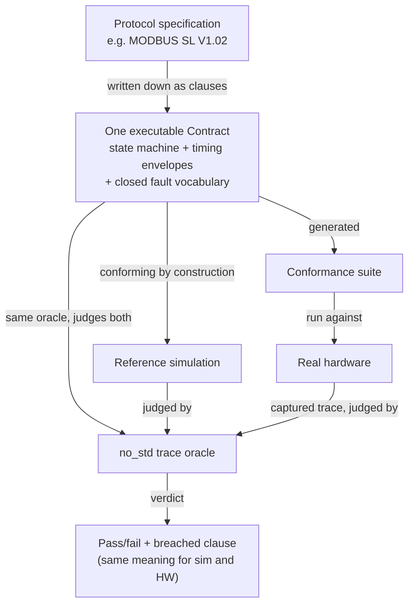
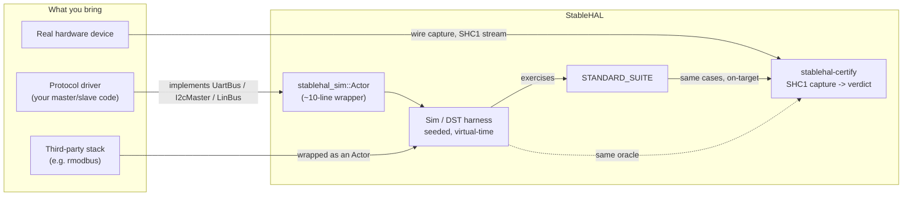
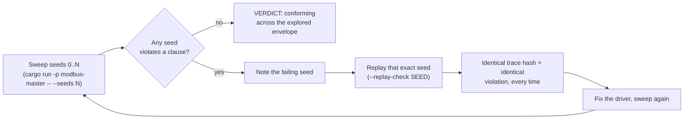

# StableHAL

**A deterministic, contract-enforcing HAL + integrated simulation environment.**
The HAL boundary becomes an executable contract; simulation explores the whole
agreed envelope deterministically; hardware is certified against the *same*
oracle. The recurring integration test collapses into a one-time
per-hardware-revision conformance certification.

Pilot protocol: **MODBUS RTU over UART** (FC 03/06/10 subset, unicast).
See [paper/whitepaper.md](paper/whitepaper.md) for the full argument, related
work, traceability table, and measured results.

## What is this for?

Test protocol drivers with zero hardware. Every simulated run is a pure
function of a seed, so every failure a sweep finds replays byte-for-byte —
no more "it happened once and we couldn't reproduce it." Certify real
hardware against the *same* oracle that judged the simulation, so a passing
simulator run and a passing hardware capture mean the same thing.

## Start here

New to the project? [docs/getting-started.md](docs/getting-started.md) is a
linear, ~15-minute walkthrough from `git clone` to your own actor running
under DST with a contract watching the wire. The short version:

```sh
cargo run -p hello-sim
```

## The idea in one paragraph

A plain HAL is a signature: it binds neither software nor hardware to any
behavior, timing, or fault envelope — so simulation and hardware drift apart
and every release needs an integration test. StableHAL writes the agreement
down as a deterministic state machine whose timing terms are envelopes
(`min..=max`) and whose faults form a closed vocabulary: hardware's real
nondeterminism becomes *bounded nondeterminism inside the contract*. One
contract yields three artifacts: a reference simulation (conforming by
construction), a `no_std` trace oracle (judges simulated runs and hardware
captures alike), and a generated conformance suite. Software passes
deterministic simulation testing (DST) across the whole envelope; hardware
passes the suite; interoperation follows by transitivity — to the extent the
contract is complete, which is the honest, stated limit.



One contract, three artifacts, one oracle judging both sides — that's the
whole mechanism the rest of this document walks through.

## Quick start

Requires a stable Rust toolchain (1.96+). All host crates use only `std`/the
standard registry-free workspace — no network fetch is needed except for the
`adapters/rmodbus-slave` experiment.

```sh
cargo test                                                   # full verification (all crates)
cargo run --release -p buggy-slave                           # closed-loop conformance demo
cargo run --release -p modbus-master -- --seeds 10000        # DST envelope sweep
cargo run --release -p modbus-master -- --replay-check 4242  # determinism proof
./scripts/verify.sh                                          # the full CI gate + reproduction
```

Expected: the reference slave passes 13/13 conformance cases while six
deliberately buggy slaves each fail with the exact breached clause named; the
10,000-seed sweep judges ~9.9M wire events with 0 violations and 0 silent data
corruptions in ~10 s; same-seed replay hashes are identical
(`95f0e863d22deaa9`).

## Integrating your own driver or device (three paths)

| You have… | Do this | Guide |
|---|---|---|
| A **protocol driver** (master/slave state machine) | Write it against the `UartBus` / `I2cMaster` / `LinBus` trait + a `now: Nanos` tick — no `std`, no clock, no executor. Adapt it into `stablehal_sim::Actor` (a ~10-line wrapper) and sweep it under DST. | [uart](docs/user-guide-uart.md), [simulator](docs/user-guide-simulator.md) |
| A **third-party stack** to evaluate | Wrap it in an `Actor` that pumps bytes through the HAL boundary and run `STANDARD_SUITE` against it, unmodified. `adapters/rmodbus-slave` is a complete worked example. | [conformance](docs/user-guide-conformance.md) |
| A **hardware device** to certify | Capture wire traffic as an SHC1 stream and judge it with `stablehal-certify` — the *same* oracle that judged simulation. | [containment](docs/user-guide-containment.md) |



The load-bearing property throughout: the judging code is `no_std` and runs
byte-identically on host and target, so a simulator verdict and a
hardware-capture verdict cannot silently diverge.

## Documentation

Recommended reading order: this README → getting-started → the protocol
guide you need → architecture.md for the why. Full API reference is also
available locally via `cargo doc --open -p stablehal` (or scope it to one
crate, e.g. `cargo doc --open -p stablehal-sim`).

| Document | Contents |
|---|---|
| [docs/getting-started.md](docs/getting-started.md) | Linear tutorial: clone → run the demos → write and simulate your own actor pair → attach a contract → certify an implementation |
| [docs/architecture.md](docs/architecture.md) | arc42 architecture (context, building blocks, runtime, deployment — with mermaid diagrams), ADRs, risks, engineering ground rules, golden values, glossary |
| [docs/user-guide-uart.md](docs/user-guide-uart.md) | `UartBus`, driver conventions, the line contract, backend checklist |
| [docs/user-guide-simulator.md](docs/user-guide-simulator.md) | Sim & DST harness: actors, observers, sweeps, reproducing failures |
| [docs/user-guide-modbus.md](docs/user-guide-modbus.md) | Master/slave drivers, PDU toolbox, the 12-clause RTU wire contract |
| [docs/user-guide-i2c.md](docs/user-guide-i2c.md) | I2C transaction contract, register-pointer device, `I2cWorld` |
| [docs/user-guide-lin.md](docs/user-guide-lin.md) | LIN schedule-table contract, `LinWorld` |
| [docs/user-guide-spi.md](docs/user-guide-spi.md) | SPI chip-select/mode/transfer-timing contract, register-pointer device, `SpiWorld` |
| [docs/user-guide-can.md](docs/user-guide-can.md) | CAN broadcast-node contract, the `CanNodeActor` topology, the request/response convention layered on top, `CanWorld` |
| [docs/user-guide-conformance.md](docs/user-guide-conformance.md) | Running/reading the suite, certifying a slave, adding cases |
| [docs/user-guide-containment.md](docs/user-guide-containment.md) | Envelope containment: proving the sim exercised where the hardware lives |
| [next_steps.md](next_steps.md) | Open backlog (hardware bring-up, remaining suites) |
| [ChangeLog.txt](ChangeLog.txt) | Versioned change history, incl. contract versions |

## Workspace layout

`no_std` = runs on host and on target unchanged. `crates/*` carry **zero
external dependencies** (rule G1); third-party code lives only under
`adapters/`, `targets/`, `tools/`.

| Crate | Role | `no_std` |
|---|---|---|
| `crates/stablehal` | Facade: one dependency + one `prelude`, feature-gated re-exports of the crates below | core ✓ |
| `crates/stablehal-contract` | Contract kernel: `Contract`/`Oracle`, timing envelopes, clauses w/ citations, virtual time, seeded PRNG, trace hash, envelope accumulator | ✓ |
| `crates/stablehal-uart` | UART HAL: `UartBus` trait + wire-level line contract | ✓ |
| `crates/stablehal-modbus` | MODBUS RTU contract (12 clauses), master driver, reference slave + bug catalog | ✓ |
| `crates/stablehal-i2c` | I2C transaction contract (7 clauses), register-pointer device, scripted master | ✓ |
| `crates/stablehal-lin` | LIN contract (9 clauses), schedule master, table slave | ✓ |
| `crates/stablehal-spi` | SPI wire contract (7 clauses), register-pointer device, scripted master | ✓ |
| `crates/stablehal-can` | CAN 2.0B data-link contract (9 clauses), broadcast-node model (`CanNodeActor`), scripted tester + register responder | ✓ |
| `crates/stablehal-embedded-hal` | Bridge to the `embedded-hal` ecosystem (spi/can features) | ✓ |
| `crates/stablehal-shc1` | SHC1 binary capture stream codec | ✓ (+alloc) |
| `crates/stablehal-sim` | Deterministic simulator + DST harness; `i2c`/`lin`/`spi`/`can` worlds | host |
| `crates/stablehal-conformance` | Conformance suite (cases `no_std`; runner behind default `runner` feature) | core ✓ |
| `tools/stablehal-certify` | SHC1 capture → certificate / envelope-containment CLI | host |
| `adapters/rmodbus-slave` | Third-party `rmodbus` stack behind `UartBus` (whitepaper E5) | host |
| `examples/hello-sim` | Tutorial artifact: smallest complete two-actor simulation + one-clause contract | host |
| `targets/rp2040` | On-target tester/DUT firmware (drafted, unverified — needs hardware) | target |
| `examples/modbus-master`, `examples/buggy-slave` | DST sweep + closed-loop demo CLIs | host |

## Determinism guarantees

* Virtual time only — wall clock appears nowhere.
* One seeded `SplitMix64` stream is the only entropy source (latencies inside
  contract envelopes, fault injection).
* Event-queue ties break by insertion sequence number; total order is `(at, seq)`.
* Therefore a run is a pure function of (config, seed, actors); every failure
  reproduces byte-for-byte from its seed (FNV-1a trace hash asserted in tests).



Same config + same seed + same actors ⇒ same trace hash, always — that's
what turns "it failed once and we couldn't reproduce it" into a one-line
replay command.

## Status

Closed-loop pilots (contract + reference driver/device + simulator world + DST
closed-loop test, each with its own conformance suite): **MODBUS RTU, I2C,
LIN, SPI, CAN**. MODBUS additionally has a simulation-validated hardware
capture/certify path (SHC1 + `stablehal-certify`); envelope containment
(proving the DST loop actually exercised the timing region a captured trace
occupies) is piloted on MODBUS, I2C, and LIN.

Open work is tracked in [next_steps.md](next_steps.md) and architecture.md §11
(risks/debt): on-target hardware certification (`targets/rp2040`, drafted but
unverified) is the main one — envelope containment for SPI/CAN and CAN's
multi-node topology are smaller, unscheduled follow-ups.
