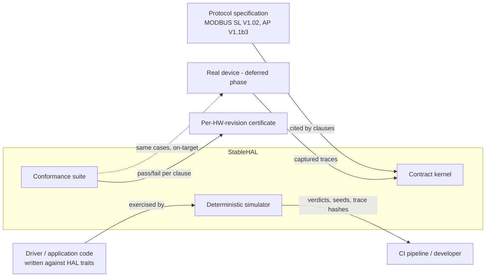
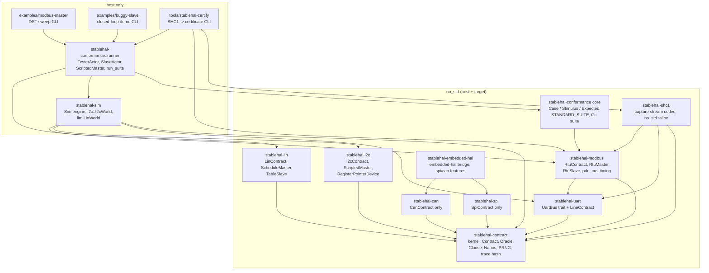
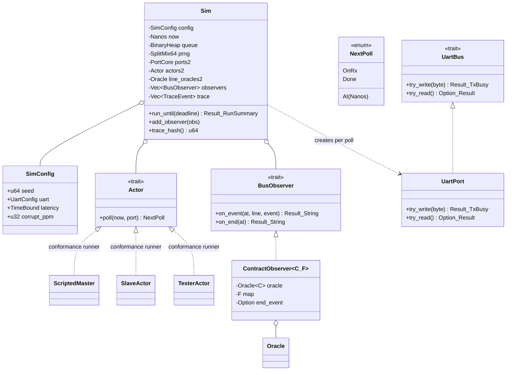
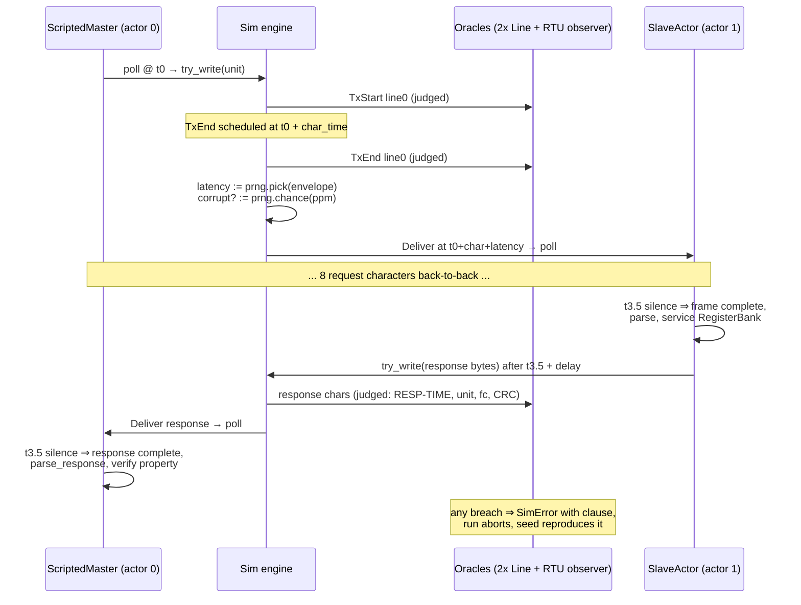
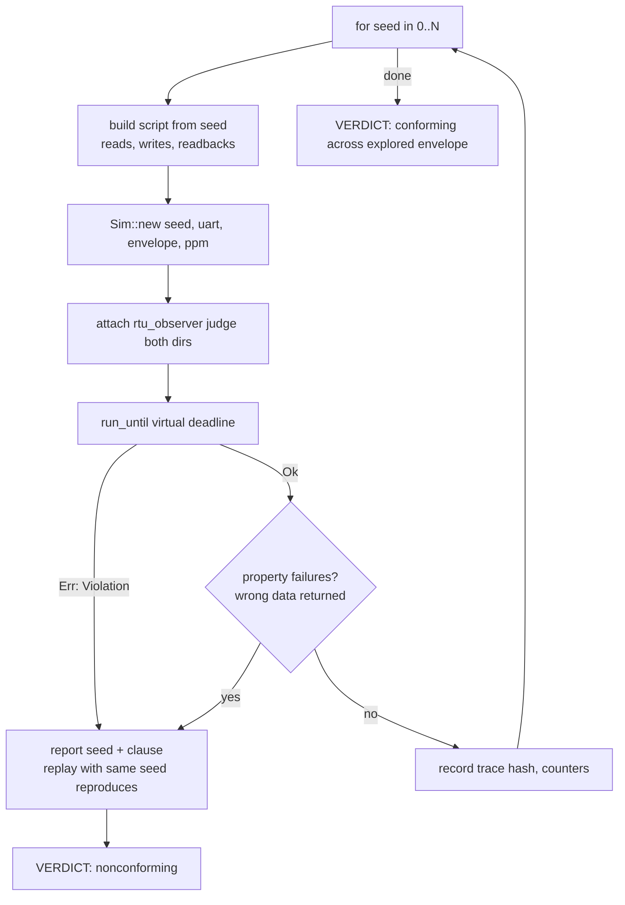
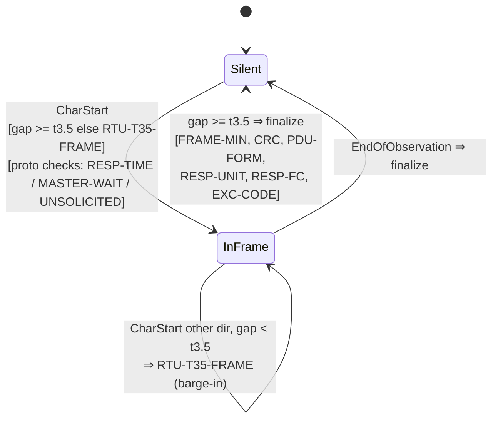
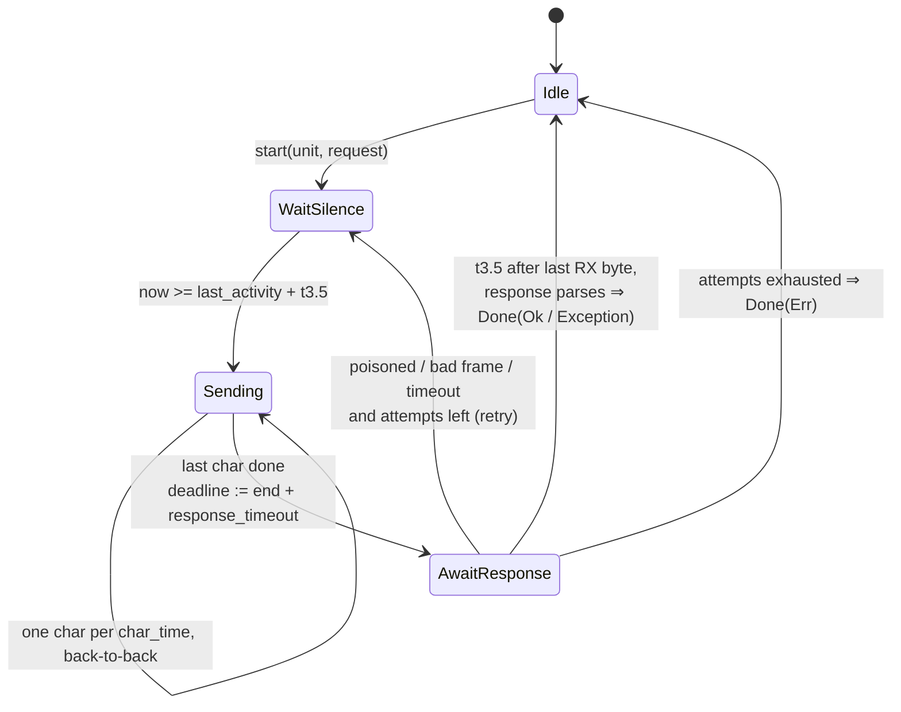
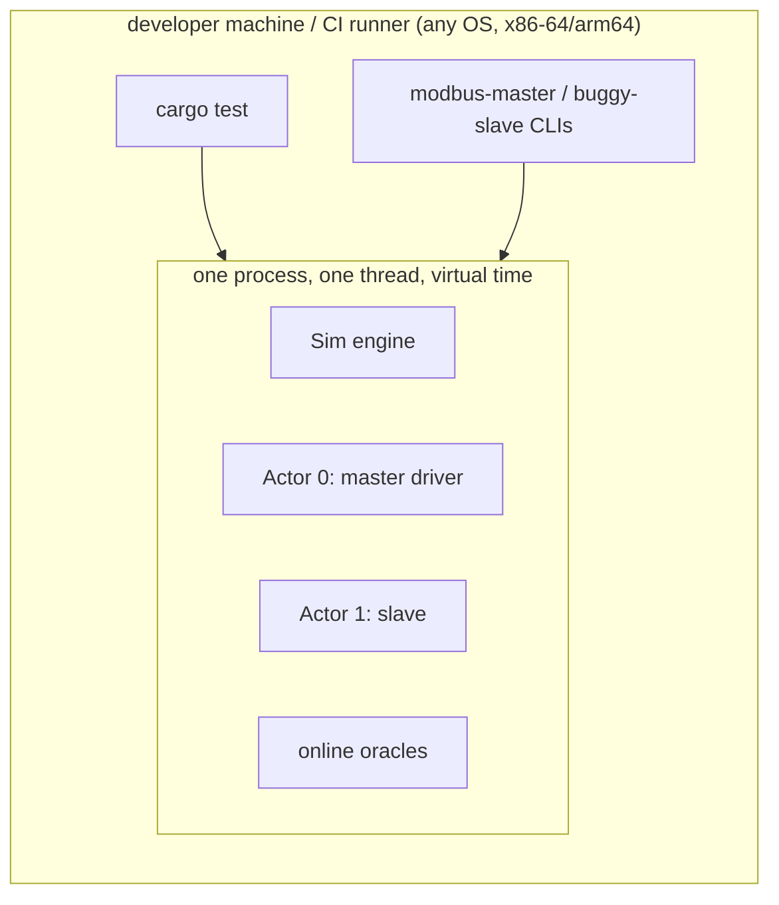
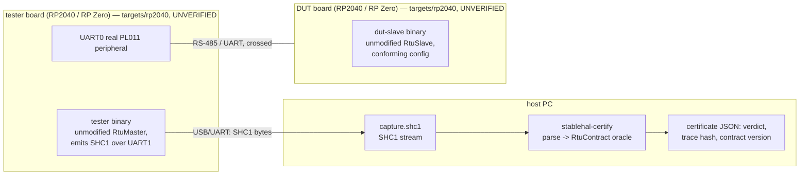

# StableHAL — Architecture Specification (arc42)

Version 0.1.0 — updated 2026-07-09 — status: MODBUS RTU/I2C/LIN closed-loop pilots implemented (M0–M4, WP2), SPI/CAN contract-only (ADR-10), hardware capture/certify path validated in simulation, envelope containment certification piloted on MODBUS RTU (ADR-11), on-target firmware drafted but unverified (§7.2).

This document follows the [arc42](https://arc42.org) template. Code references
point into this repository; the scientific argument lives in
[paper/whitepaper.md](../paper/whitepaper.md).

---

## 1. Introduction and Goals

### 1.1 Requirements overview

Embedded software validated against HAL-level simulation still fails on real
hardware, forcing a costly integration test per release. Root cause: a HAL is
an interface *signature*, not an *agreement* — it binds neither side to
behavior, ordering, timing, or fault envelopes.

StableHAL's requirement set:

| Id | Requirement |
|----|-------------|
| R1 | The HAL boundary is governed by an **executable contract**: state machine + timing envelopes + closed fault vocabulary, each clause citing the governing spec. |
| R2 | A **simulation environment** explores the *entire* contract-allowed envelope deterministically (seeded), not a single happy-path trace. |
| R3 | The **same oracle** judges simulated traces and hardware captures (`no_std`), closing the SW↔HW loop. |
| R4 | A **conformance suite** is derived from the contract and can run against simulated and real devices alike. |
| R5 | Every failure **replays byte-for-byte from its seed**. |
| R6 | Pilot protocols: MODBUS RTU over UART (FC 03/06/10 subset, unicast) — full closed loop, incl. conformance suite and (simulation-validated) hardware capture path; I2C and LIN — full closed loop, contract + reference driver/device + DST; SPI and CAN — contract-only (ADR-10), closed loop not yet demonstrated. |

### 1.2 Quality goals (top 3)

| Priority | Quality | Scenario |
|---|---|---|
| 1 | **Determinism / reproducibility** | Re-running any seed produces an identical wire trace (asserted by FNV-1a trace hash). No wall clock, no OS entropy, no hash-order dependence anywhere. |
| 2 | **Verdict precision** | Every violation names one clause, with measured-vs-required values and a spec citation; a conforming implementation is never falsely accused. |
| 3 | **Portability of judgement** | Contract kernel, protocol contracts, drivers and conformance case definitions are `no_std`, so on-target execution requires no rework of the judging code. |

### 1.3 Stakeholders

| Stakeholder | Concern |
|---|---|
| Device-driver developers | Write drivers against `UartBus`-style traits; test across the full envelope on the host. |
| Hardware/board vendors | Certify a board revision once against the conformance suite. |
| Application developers | Trust that "passes DST + certified HW" composes without per-release integration testing. |
| Researchers (whitepaper) | Reproducible measurements; explicit limits of the transitivity claim. |

---

## 2. Constraints

| Id | Constraint | Rationale |
|---|---|---|
| C1 | Rust, edition 2021. | Type-state, `no_std` targets, host+MCU from one codebase. |
| C2 | **Zero external dependencies** in all `crates/*`. | Determinism auditability; nothing outside our control injects entropy or platform variance. |
| C3 | Judging code (`stablehal-contract`, `-uart`, `-modbus`, conformance case definitions) is `no_std`. | R3. |
| C4 | Virtual time only (`Nanos`, u64 nanoseconds); wall clock is forbidden in every crate. | R5. |
| C5 | One PRNG stream (`SplitMix64`) per run, seeded from the run's seed; it is the *only* entropy source. | R5. |
| C6 | Integer arithmetic only in timing derivations (`Nanos::mul_ratio`); every component derives bounds through the same functions. | Simulator, driver, and oracle must agree to the nanosecond. |

---

## 3. Context and Scope

### 3.1 Business context

### 3.2 Technical scope

**In scope, closed-loop pilots (contract + reference driver/device +
simulator world + DST closed-loop test):** UART line contract; MODBUS RTU
(§5.4); I2C transaction contract (§5.1, `docs/user-guide-i2c.md`); LIN
transaction contract (§5.5, `docs/user-guide-lin.md`, conformance suite not
yet built — T10). MODBUS additionally has a full conformance-suite runner,
a validated (simulation-only) hardware capture path
(`stablehal-shc1` + `tools/stablehal-certify`, §7.2), and an envelope
containment pilot (ADR-11, `docs/user-guide-containment.md`) proving the
DST loop actually exercised the timing region a captured trace occupies —
not just that both sides pass their own contract separately.

**In scope, contract-only (ADR-10 — clause set + state machine, no closed
loop yet):** SPI wire contract; CAN data-link contract (Classic 2.0B);
`embedded-hal` ecosystem bridge for both.

**Out of scope (documented, deliberate):** physical layer (EMI, analog
margins, silicon errata outside the fault vocabulary); MODBUS broadcast
(unit 0) and function codes beyond 03/06/10; I2C multi-master arbitration
(`I2C-ARBITRATION` reserved); LIN classic checksum (enhanced only); CAN FD
(v2); on-target execution beyond the drafted, unverified `targets/rp2040/`
firmware (§7.2).

---

## 4. Solution Strategy

| Problem | Strategy |
|---|---|
| Sim ≠ HW | Don't imitate hardware; **contractualize** it. Hardware nondeterminism becomes explicit envelopes (`TimeBound`) and a closed fault vocabulary; the simulator samples the envelope, seeded. |
| Trust in the simulator | The wire is *conforming by construction* **and** still judged online by the same oracle — the claim is checked every run, not assumed. |
| Trust in hardware | The conformance suite derives from the clause list and is judged by the identical `no_std` oracle over captured traces. |
| Integration guarantee | Transitivity: DST proves SW ⊨ C over the envelope; certification proves HW ⊨ C; hence SW+HW interoperate to the extent C is complete (stated limit). |
| Tester must be able to cheat | Judgement is per-direction (`judge_master` / `judge_slave` flags): a conformance tester deliberately violates master-side clauses while the DUT stays fully judged. |

---

## 5. Building Block View

### 5.1 Level 1 — workspace

Dependency rule: arrows only point "down" toward the kernel. `stablehal-sim`
never depends on `stablehal-modbus`; protocol knowledge reaches the simulator
only through the `BusObserver` interface.

**I2C (WP2 §2.2)** is a second, independent protocol stack added alongside
MODBUS, deliberately not sharing code beyond the kernel: `stablehal-i2c`
(`no_std`: `I2cContract`, `I2cMaster`/`I2cSlaveDevice` traits,
`RegisterPointerDevice`, `ScriptedMaster`) depends only on
`stablehal-contract`, mirroring `stablehal-modbus`'s shape but with its own
event enum (`I2cEvent`, never merged with `LineEvent`). `stablehal-sim`
gained a second, self-contained world — `stablehal_sim::i2c::I2cWorld` — that
builds its own `Scheduler<Job>` the same way `Sim` does, rather than reusing
`Sim`'s 2-actor UART-shaped engine. `stablehal-conformance::i2c` follows the
same `no_std`-core / `runner`-feature split as the MODBUS suite. See
`docs/user-guide-i2c.md` for the full API walkthrough and clause table.

**LIN (`stablehal-lin`)** is a third, independent protocol stack, same
shape again: depends only on `stablehal-contract`, its own event enum
(`LinEvent`), and `stablehal_sim::lin::LinWorld` as a third self-contained
`Scheduler<Job>` world. Structurally distinct from both priors — no
arbitration (unlike I2C), no request/response coupling (unlike MODBUS): the
master's only recurring obligation is a conforming header on schedule (TDMA
via a fixed schedule table), while whichever slave owns a frame ID (if any)
carries a separate, independently-judged obligation to answer correctly.
See `docs/user-guide-lin.md` for the full walkthrough. Has a closed-loop DST
test (`crates/stablehal-sim/tests/lin_dst.rs`) but not yet a
`stablehal_conformance::lin` case suite.

**SPI and CAN (`stablehal-spi`, `stablehal-can`)** are contract-only so far:
each defines its clause set, event enum, and `Contract` state machine
(SPI: CS timing/mode discipline/mode-fault, byte granularity; CAN: ISO
11898-1 Classic 2.0B frame fields, bit-stuffing, CRC, ACK, error frames —
CAN FD deferred to v2), but neither yet has a reference master/slave driver,
a `stablehal-sim` world, or a conformance suite — so neither has closed the
DST loop the way MODBUS/I2C/LIN have. Treat as contract specifications
awaiting the driver/simulator/suite layers, not yet full pilots.
`stablehal-embedded-hal` bridges StableHAL's contract-aware traits to the
Rust `embedded-hal` ecosystem (`spi`/`can` feature-gated adapters) so
existing `embedded-hal` drivers can eventually be exercised under DST.

#### Clause registry

| Contract | Version | Clauses | Certificate `contract` code | DST closed loop |
|---|---|---|---|---|
| uart-line | 0.1 | 3 | 0x0002 | via modbus-rtu |
| modbus-rtu | 0.1 | 12 | 0x0001 | yes |
| i2c | 0.1 | 7 | 0x0003 (reserved) | yes |
| lin | 0.1 | 9 | unassigned | yes (no conformance suite yet) |
| spi | — | 7 | unassigned | no (contract only) |
| can | — | 9 | unassigned | no (contract only) |

modbus-rtu additionally has an envelope containment pilot (§5.6, ADR-11):
its 4 timing clauses (`RTU-T35-FRAME`, `RTU-T15-INTRA`, `RTU-MASTER-WAIT`,
`RTU-RESP-TIME`) can be measured, not just judged pass/fail, and compared
against what the DST loop actually exercised.

I2C v1 clauses (full text and citations in `docs/user-guide-i2c.md` §5):
`I2C-SEQ`, `I2C-BUS-FREE`, `I2C-BYTE-TIME`, `I2C-READ-NACK-LAST`,
`I2C-ADDR-ACK`, `I2C-STRETCH-MAX`, `I2C-WRITE-ACK`. `I2C-ARBITRATION` is
reserved for v2 multi-master support and is not implemented.

LIN v1 clauses (full text and citations in `docs/user-guide-lin.md` §6):
`LIN-BREAK`, `LIN-BREAK-DELIM`, `LIN-SYNC`, `LIN-PID-PARITY`,
`LIN-FRAME-MAXLEN`, `LIN-INTERBYTE-MAX`, `LIN-CHECKSUM`,
`LIN-SLAVE-SILENCE`, `LIN-ONE-RESPONSE`.

SPI clauses (`crates/stablehal-spi/src/lib.rs` doc comment):
`SPI-CS-TIMING`, `SPI-MODE-DISC`, `SPI-XFER-TIME`, `SPI-DATA-VALID`,
`SPI-MODE-FAULT`, `SPI-TRANSACTION`, `SPI-CS-MIN-IDLE`.

CAN clauses (`crates/stablehal-can/src/lib.rs` doc comment):
`CAN-FRAME-START`, `CAN-ID-FIELD`, `CAN-RTR-DISC`, `CAN-CRC`, `CAN-ACK`,
`CAN-EOF`, `CAN-ERROR-FRAME`, `CAN-BIT-STUFFING`, `CAN-OVERLOAD` (overload
frame handling deferred).

### 5.2 Level 2 — domain model (kernel)

### 5.3 Level 2 — simulator

Key mechanism: drivers (`RtuMaster`, `RtuSlave`) are `no_std` poll-driven
state machines written **only** against `UartBus` + a `now: Nanos` parameter.
The sim adapts them via thin `Actor` wrappers. On target the same drivers are
polled from an ISR/loop with a hardware timebase.

### 5.4 Level 2 — MODBUS building blocks

| Block | File | Responsibility |
|---|---|---|
| `crc` | [crc.rs](../crates/stablehal-modbus/src/crc.rs) | CRC-16/MODBUS + `check()` (wire order low-first). |
| `timing` | [timing.rs](../crates/stablehal-modbus/src/timing.rs) | `RtuTiming`: t1.5 / t3.5 (fixed values > 19200 baud), response envelope. |
| `pdu` | [pdu.rs](../crates/stablehal-modbus/src/pdu.rs) | `Adu` (256-byte, no-alloc frame buffer), request/response builders and validating parsers. |
| `contract` | [contract.rs](../crates/stablehal-modbus/src/contract.rs) | `RtuContract`: 12 clauses over `CharStart/CharEnd/EndOfObservation` events; per-direction judgement; frame assembly with poisoning semantics for waived violations. |
| `master` | [master.rs](../crates/stablehal-modbus/src/master.rs) | `RtuMaster`: WaitSilence → Sending → AwaitResponse FSM, t3.5 frame detection, retries, planted-bug knob. |
| `slave` | [slave.rs](../crates/stablehal-modbus/src/slave.rs) | `RtuSlave` + `RegisterBank` + `SlaveBugs` catalog (each bug breaks exactly one clause). |

### 5.5 Level 2 — LIN building blocks

| Block | File | Responsibility |
|---|---|---|
| `timing` | [timing.rs](../crates/stablehal-lin/src/timing.rs) | `LinTiming`: break/delimiter minimums, byte time, header/response/frame budgets — all derived from one nominal `bit_time`. |
| `contract` | [contract.rs](../crates/stablehal-lin/src/contract.rs) | `LinContract`: 9 clauses over frame-field events (`Break`/`Sync`/`Pid`/`DataByte`/`Checksum`); `enhanced_checksum`, `encode_pid`/`pid_parity_ok` helpers. |
| `master` | [master.rs](../crates/stablehal-lin/src/master.rs) | `ScheduleMaster`: TDMA schedule-table driver — send header, wait out response window, advance to the next slot. No request/response coupling (unlike MODBUS). |
| `device` | [device.rs](../crates/stablehal-lin/src/device.rs) | `TableSlave` (fixed signal-table publisher) + `LinSlaveBugs` catalog (`corrupt_checksum`, `respond_to_unowned`, `silent_on_owned`). |

`stablehal_sim::lin::LinWorld` executes one scheduled slot per engine step
(not byte-at-a-time like I2C's addressing phase): emit the jittered header,
then either the jittered response burst + checksum or `NoResponse`. See
`docs/user-guide-lin.md` §7 for a documented pitfall found during
development — break/delimiter timing is floor-only (no contractual
maximum), so the engine must jitter with `jitter_at_least(min)` rather than
the symmetric jitter used for byte/inter-byte gaps, or the reference master
can occasionally breach its own contract.

### 5.6 Level 2 — envelope containment (MODBUS RTU pilot, ADR-11)

| Block | File | Responsibility |
|---|---|---|
| `measure` | [measure.rs](../crates/stablehal-contract/src/measure.rs) | `Measurement`, `ClauseHull`, `EnvelopeAccumulator<N>` — `no_std`, fixed-capacity per-clause min/max/sample fold. |
| `oracle::check_trace_measured` | [oracle.rs](../crates/stablehal-contract/src/oracle.rs) | Mirrors `check_trace`; additionally folds every `step_measured` report into an `EnvelopeAccumulator`. |
| `RtuContract::step_measured` | [contract.rs](../crates/stablehal-modbus/src/contract.rs) | Reports T3.5/T1.5/master-wait/response-time durations to the sink *before* the bound check, so passing and waived measurements still contribute to the hull. |
| `sim_envelope` | [runner.rs](../crates/stablehal-conformance/src/runner.rs) | Drives the reference master/slave over N seeds, maps the wire trace to `RtuEvent`s, judges it with `check_trace_measured` — the sim-explored hull. |
| `envelope` | [envelope.rs](../tools/stablehal-certify/src/envelope.rs) | `stablehal-envelope-v1` hand-rolled JSON (G1): the hull format shared by sim and hardware sources. |
| `contain` | [contain.rs](../tools/stablehal-certify/src/contain.rs) | Per-clause `COVERED`/`UNCOVERED { gap_low_ns, gap_high_ns }`/`UNPROBED` verdict; `stablehal-certificate-v2` JSON. |

CLI: `stablehal-certify sim-envelope --seeds N`, `measure <captures>...`,
`contain --hw --sim` (plus the pre-existing `judge`, still the no-subcommand
default for compatibility). Full walkthrough and the composition argument
this closes: `docs/user-guide-containment.md`.

---

## 6. Runtime View

### 6.1 One MODBUS transaction under DST

### 6.2 DST sweep (activity)

### 6.3 RTU wire contract — line phase FSM

Protocol overlay (`Proto`): `ExpectRequest ⇄ AwaitResponse{unit, fc,
request_end}` — set by a finalized valid master frame, cleared by a finalized
slave response or a legal (post-timeout) retry.

### 6.4 Master driver FSM

---

## 7. Deployment View

### 7.1 Current (v0.1): single host process

No threads, no I/O, no clocks: determinism holds on any host. A 10,000-seed
sweep (~9.9M judged wire events) completes in ~10 s single-core; sweeps are
embarrassingly parallel across seeds if ever needed.

### 7.2 Target (hardware phase — capture/certify built and tested in simulation; firmware drafted, unverified on hardware)

**Built and verified in simulation (E7, whitepaper §7):** the SHC1 binary
capture format (`stablehal-shc1`: header/record codec, resync-on-corruption
rule) and `tools/stablehal-certify` (parses a capture, judges it with the
*same* `RtuContract` oracle used in simulation). Round-trip identity — sim
verdict == certifier-from-capture verdict, for the conforming reference and
all 6 `SlaveBugs` — is proven by
`crates/stablehal-shc1/tests/round_trip.rs` before any firmware exists.
`stablehal-certify` additionally has `measure`/`sim-envelope`/`contain`
subcommands (§5.6, ADR-11) that build and compare timing hulls from either
source through the identical `stablehal-envelope-v1` format — proven by
`tools/stablehal-certify/tests/containment.rs`, which shows a hardware hull
matching the sim's own reference traffic is `COVERED`, and one operating
outside it (still contract-conforming) is correctly `UNCOVERED`.

**Drafted, not yet verified:** `targets/rp2040/` (standalone crate, targets
`thumbv6m-none-eabi`, not a workspace member) has `Rp2040UartBus` (`UartBus`
over the real PL011 peripheral), a `dut-slave` binary (unmodified
`RtuSlave` driven over real UART0), and a `tester` binary (unmodified
`RtuMaster` drives one transaction, streams an SHC1 header +
`EndOfObservation` over UART1). None of this has been compiled, flashed, or
run — no `thumbv6m-none-eabi` target or RP2040/RP Zero hardware was
available when it was written; `rp2040-hal` 0.12 method names are from
memory and likely need fixing on first real build. Known incomplete piece:
the tester does not yet timestamp individual `TxStart`/`TxEnd` wire events
into SHC1 records (needs either a PIO-based independent bus observer, or
per-byte instrumentation of `Rp2040UartBus`) — captures are framing-valid
but presently carry no protocol content. See `targets/rp2040/README.md`
"Status" for the itemized gap list and bring-up plan.

Interface details: [design-spec-next.md §3](design-spec-next.md).

---

## 8. Crosscutting Concepts

### 8.1 Determinism (the load-bearing concept)

1. **Virtual time only.** `Nanos` is the sole time type; `std::time` is not
   imported anywhere.
2. **Single entropy source.** `SplitMix64::new(seed)`; draws happen in event
   order (defined by the queue), so consumption order is itself deterministic.
3. **Total event order.** The scheduler orders by `(at, seq)`; `seq` is the
   insertion counter — no `HashMap` iteration, no OS scheduling.
4. **Stable fingerprints.** FNV-1a over the canonical `Debug` rendering of the
   trace (integers only) — platform-independent hash, asserted equal on replay.

### 8.2 Contract semantics

* **Envelopes, not points**: every timing term is a `TimeBound`; a spec that
  says "at least t3.5" becomes `at_least(t35)`; tolerance terms (UART char
  time ±2%) are explicit contract parameters.
* **Closed fault vocabulary**: `UartError {Framing, Parity, Noise, Overrun}`
  is exhaustive; the environment may only inject from this set, and drivers
  must tolerate exactly this set.
* **Per-direction judgement with waiver semantics**: a waived (unjudged)
  breach *poisons* the affected frame — it carries no protocol meaning, which
  models how real receivers discard garbage — while the judged party remains
  fully accountable.
* **Judgement of transmitter truth**: oracles consume `TxStart/TxEnd`
  (what a party emitted), never `Delivered*` (what the channel did to it), so
  environment corruption is never blamed on an endpoint.

### 8.3 Error handling & reporting

`Breach` (clause + measured + required) → `Violation` (adds time, step,
offending event) → rendered with spec citation. Anything that fails renders a
seed and is reproducible; honest driver failures (retries exhausted) are
*results*, not violations.

### 8.4 Testing strategy

| Layer | Where | What |
|---|---|---|
| Unit | each crate `#[cfg(test)]` | CRC spec vector, timing derivations, contract clause triggers, PRNG stability. |
| DST harness self-test | [dst.rs](../crates/stablehal-sim/tests/dst.rs) | Planted envelope-dependent bug found by sweep; exact replay; seed divergence. |
| Closed loop (MODBUS) | [closed_loop.rs](../crates/stablehal-conformance/tests/closed_loop.rs) | Reference passes suite; 6/6 bug catalog caught with exact clause; master sweep clean; planted master bug caught. |
| Closed loop (I2C) | [i2c_dst.rs](../crates/stablehal-sim/tests/i2c_dst.rs), [i2c_closed_loop.rs](../crates/stablehal-conformance/tests/i2c_closed_loop.rs) | Reference passes 50-seed envelope; each `I2cSlaveBugs` entry caught with exact clause (or correctly *not* flagged, for the data-only `wrong_read_data` bug); replay-exact. |
| Closed loop (LIN) | [lin_dst.rs](../crates/stablehal-sim/tests/lin_dst.rs) | Reference passes 50-seed envelope; `corrupt_checksum`/`silent_on_owned` caught with exact clause; replay-exact. No conformance-suite layer yet (T10). |
| Capture round-trip | [round_trip.rs](../crates/stablehal-shc1/tests/round_trip.rs) | Sim-side oracle verdict == certifier-from-SHC1-capture verdict, for the reference and all 6 `SlaveBugs` — validates the hardware-capture path before any firmware exists. |
| Envelope containment | [envelope.rs](../crates/stablehal-conformance/tests/envelope.rs), [containment.rs](../tools/stablehal-certify/tests/containment.rs) | `sim_envelope` measures every timing clause on a conforming reference run; a "hardware" capture matching the sim's own reference traffic is `COVERED`, one operating outside it (still contract-conforming) is `UNCOVERED` — proves the check has teeth, not just that it type-checks. |
| Measurement | example CLIs | 10k-seed sweep, replay check — numbers feed the whitepaper. |

---

## 9. Architecture Decisions (ADRs)

| # | Decision | Status | Rationale / consequences |
|---|---|---|---|
| ADR-1 | Contracts judge **wire truth per direction**, not deliveries. | accepted | Correct fault attribution under injected corruption; conformance testers can deliberately violate their own direction. |
| ADR-2 | Drivers are **poll-driven `no_std` state machines** (`poll(now, bus)`), not async. | accepted | Runs identically under sim scheduling and on bare metal; no executor dependence; wake-hint (`wake_at`) keeps sims efficient. |
| ADR-3 | **Zero external crates** in `crates/*`. | accepted, with one deliberate exception | Auditable determinism; cost: hand-rolled PRNG/hash (~60 LoC), no rmodbus in core (adapter lives outside `crates/`). Exception: `stablehal-embedded-hal` depends on `embedded-hal`/`embedded-io`/`embedded-can` — its entire purpose is bridging to that ecosystem, so the exception is the point, not a lapse; every other `crates/*` member (`stablehal-shc1` included) still depends only on `stablehal-contract` and, where relevant, `stablehal-uart`/`stablehal-modbus`. |
| ADR-4 | Simulator is **conforming by construction *and* self-judged**. | accepted | The "environment contract" claim is verified every run; a sim bug surfaces as a line-oracle violation (`SimError::Line`). |
| ADR-5 | Sim topology fixed at **2 devices / 2 simplex lines** for v0.1. | accepted | Covers master/slave pilot; multi-drop & shared buses (I2C) require the Medium abstraction — see [design-spec-next.md §2](design-spec-next.md). |
| ADR-6 | Higher-layer contracts attach via **`BusObserver`**, keeping `sim` protocol-agnostic. | accepted | `stablehal-sim` never imports modbus; new protocols plug in without touching the engine. |
| ADR-7 | Frame-oriented contracts get an explicit **`EndOfObservation`** event. | accepted | A trailing frame cannot escape judgement; harnesses must append it (the sim does this in `run_until`). |
| ADR-8 | Waived breaches **poison** frames instead of halting. | accepted | Lets one oracle instance serve both strict DST (judge all) and conformance probing (judge DUT only). |
| ADR-9 | `Adu` is a fixed 256-byte buffer (spec max), cloned freely. | accepted | No alloc in `no_std`; clippy "large enum variant" warnings accepted knowingly. |
| ADR-10 | A protocol crate may ship **contract-only** (clause set + `Contract` state machine, no reference driver/device/sim world) as a valid intermediate state. | accepted | `stablehal-spi`/`stablehal-can` are contract-only today; `stablehal-modbus`/`stablehal-i2c`/`stablehal-lin` have closed the full DST loop. A contract-only crate is a real, checkable artifact (its clauses are already spec-traceable and unit-testable) but has *not* demonstrated the closed-loop claim — do not cite it as pilot evidence until a reference driver + `stablehal-sim` world + DST closed-loop test exist, mirroring the other three. |
| ADR-11 | Timing measurement is a **side channel of judging**, not a second implementation of the bounds: `Contract::step_measured` defaults to delegating to `step` with a no-op sink, and a contract that overrides it has `step` call back into `step_measured` — exactly one code path computes a duration and checks it. | accepted | Prevents the sim-explored hull and the hardware-measured hull from silently drifting apart from the pass/fail verdict they're supposed to explain. Piloted on `RtuContract` only (§5.6); other contracts keep compiling against the trait default with an empty hull. |

---

## 10. Quality Requirements (scenarios)

| Quality | Scenario | Measure (v0.1 actual) |
|---|---|---|
| Reproducibility | Re-run any failing seed | identical trace hash + identical violation (asserted in CI) |
| Bug-finding power | Planted ~1%-per-transaction timing bug | found within 200 seeds; single mock trace misses it |
| Verdict precision | 6 cataloged slave bugs | 6/6 attributed to the exact clause; reference 13/13 pass |
| Throughput | 10,000-seed sweep | ~10 s single core, ~9.9M events judged |
| Safety property | 0.2%/char corruption injected | 0 silent data corruptions; failures are loud (retry-then-error) |

---

## 11. Risks and Technical Debt

| Id | Risk / debt | Mitigation |
|---|---|---|
| T1 | **Contract completeness** — a wrong-but-consistent contract passes both sides. | Clause↔spec traceability table; boundary probes at both envelope edges; treat field divergence as contract bugs (fix upgrades all three artifacts). |
| T2 | Envelope coverage is sampled, not exhausted. | Explicit envelope parameters; scale seeds in CI; planned boundary-biased sampling ([design-spec-next.md §4](design-spec-next.md)). |
| T3 | Response-timeout race (spec ambiguity: retry may collide with a maximally-late response). | Contract makes the race visible; deployments configure margins; documented in whitepaper §6. |
| T4 | `Sim` (the original UART/MODBUS engine) is hardcoded to 2 devices / 2 simplex lines. | Resolved for multi-drop protocols by *not* extending `Sim` — `I2cWorld`/`LinWorld` are separate `Scheduler`-based engines supporting N devices via `add_slave` (ADR-6/ADR-10 pattern). `Sim` itself stays 2-device; do not extend it ad hoc. |
| T5 | `expected_request_len` in [slave.rs](../crates/stablehal-modbus/src/slave.rs) exists only to implement a *bug* (early response); keep it out of reference paths. | Code comment + conformance case GAP-T15-ACCEPTED guards the legal path. |
| T6 | Clippy warnings (large enum variants, complex runner types). | Accepted for v0.1 (ADR-9); revisit if `Adu` clones show up in profiles. |
| T7 | The conformance tester's listening window is length-aware but static. | Fine at 9600–115200 baud; recompute per case if very slow bauds are added. |
| T8 | `stablehal-spi`/`stablehal-can` are contract-only (ADR-10) — no reference driver, no `stablehal-sim` world, no DST closed-loop test, no conformance suite. | Do not cite SPI/CAN as pilot evidence in the whitepaper or elsewhere until the driver/world/suite layers close the loop, mirroring MODBUS/I2C/LIN. Tracked as backlog, not yet in `next_steps.md`. |
| T9 | `targets/rp2040/` firmware (T7 hardware phase) is drafted but **unverified**: never compiled (no `thumbv6m-none-eabi` installed), never flashed, `rp2040-hal` API calls written from memory. | See `targets/rp2040/README.md` "Status" for the itemized gap list; fix on first real build once hardware is available. |
| T10 | `stablehal-lin` has a closed-loop DST test but no `stablehal_conformance::lin` case suite yet (unlike MODBUS/I2C). | Add a LIN conformance suite following the I2C suite's pattern (`stablehal_conformance::i2c`) when prioritized. |
| T11 | Envelope containment (§5.6, ADR-11) is piloted on `modbus-rtu` timing clauses only; I2C/LIN/SPI/CAN contracts still use the `step_measured` trait default (empty hull) — containment cannot be claimed for them yet. Containment is also min/max only, not a statistical/percentile guarantee. | Extend `step_measured` to I2C/LIN when prioritized, mirroring the MODBUS pattern (§5.6); document the min/max-only scope in any external certificate language rather than overstating it as a probabilistic bound. |

---

## 12. Glossary

| Term | Meaning |
|---|---|
| **ADU / PDU** | MODBUS Application Data Unit (unit + PDU + CRC) / Protocol Data Unit (fc + data). |
| **Bounded nondeterminism** | Real-world variance expressed as an explicit contract envelope (`TimeBound`) or closed fault set, so it can be sampled and judged. |
| **Break field / break delimiter** | LIN: the master's dominant-then-recessive preamble (>=13 bit times low, >=1 bit time high) that opens every frame. |
| **Certificate** | JSON verdict emitted by `stablehal-certify`: contract id/version, UART framing, derived timing envelope, capture record/gap counts, trace hash, verdict (v1: `judge`); v2 additionally reports per-clause containment (`contain`). |
| **Clause** | One checkable obligation, with stable id and spec citation. |
| **Clause hull** | The observed `min..=max` and sample count for one timing clause across a trace or a folded set of traces (`ClauseHull`, §5.6). |
| **Conforming by construction** | The simulated wire physically cannot emit contract-forbidden character patterns (and is still judged online). |
| **Contract-only crate** | A protocol crate shipping a clause set + `Contract` state machine but no reference driver/device/sim world yet (ADR-10) — a real artifact, but has not closed the DST loop. |
| **DST** | Deterministic simulation testing: all nondeterminism seeded and pluggable; failures replay from the seed. |
| **DUT** | Device under test (conformance). |
| **Envelope** | The `min..=max` band of allowed values for a timing term. |
| **Envelope containment** | The check that a hardware-measured clause hull sits inside the sim-explored clause hull — proof the DST loop tested where the hardware actually operates, not just that both sides pass their own contract separately (§5.6, ADR-11, `docs/user-guide-containment.md`). |
| **Oracle** | Folds a timestamped event trace through a contract; yields conformance or the breached clause. |
| **PID (Protected Identifier)** | LIN: the 6-bit frame ID plus 2 parity bits computed per the LIN 2.2A formula, sent as one byte after sync. |
| **Poisoned frame** | Frame stripped of protocol meaning after a waived (unjudged) breach — models receivers discarding garbage. |
| **Schedule table** | LIN: the fixed, TDMA-ordered list of frame IDs the master polls in sequence — LIN has no arbitration, so this replaces bus contention entirely. |
| **SHC1** | The binary capture stream format (`stablehal-shc1`): header + fixed-size records, resync-tolerant, judged by the same oracle as simulation. |
| **t1.5 / t3.5** | MODBUS RTU character-time multiples bounding intra-frame gaps / delimiting frames (fixed 750 µs / 1.75 ms above 19200 baud). |
| **Trace hash** | FNV-1a fingerprint of the canonical wire trace; equality across runs proves replay exactness. |
| **Waiver** | Direction excluded from judgement so a tester may deliberately violate; never applied to the DUT. |
