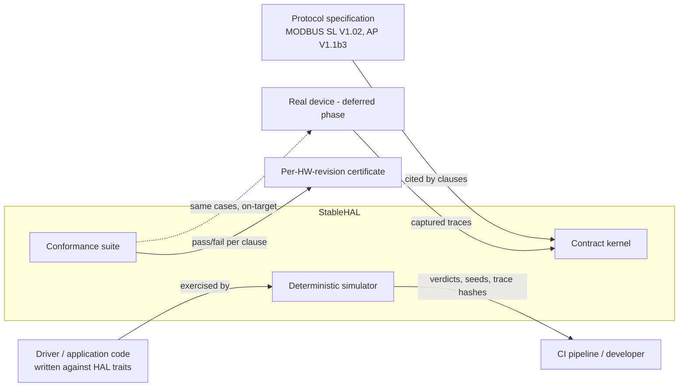
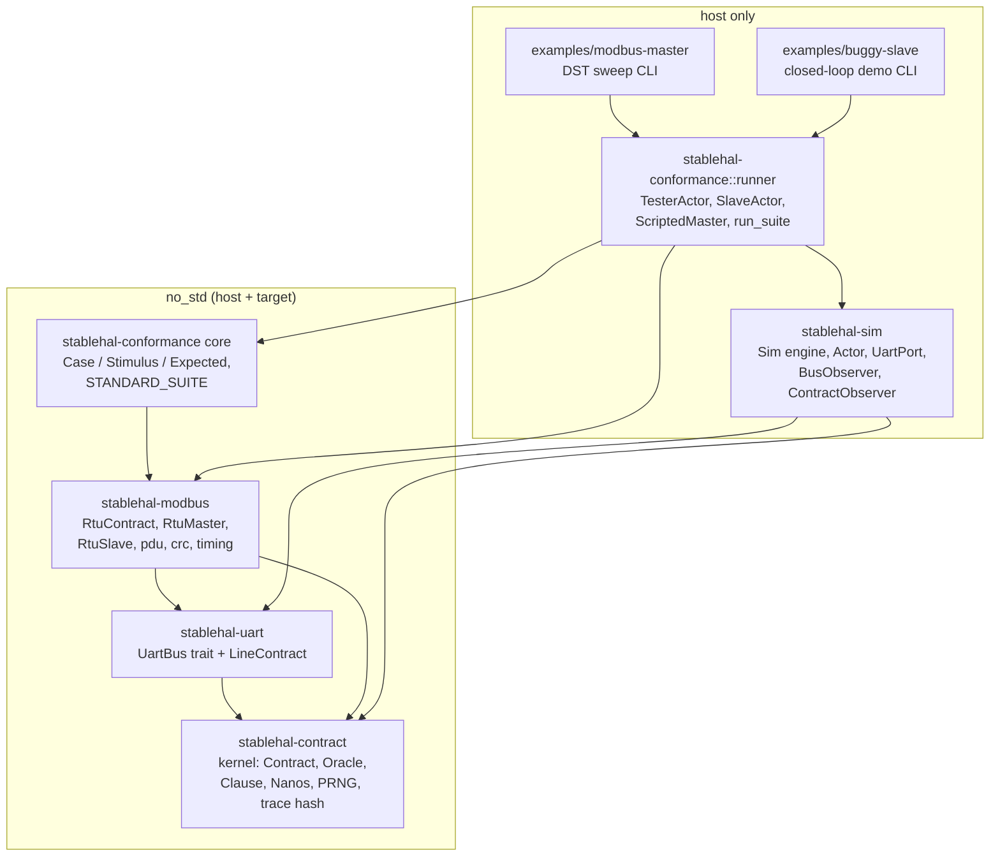
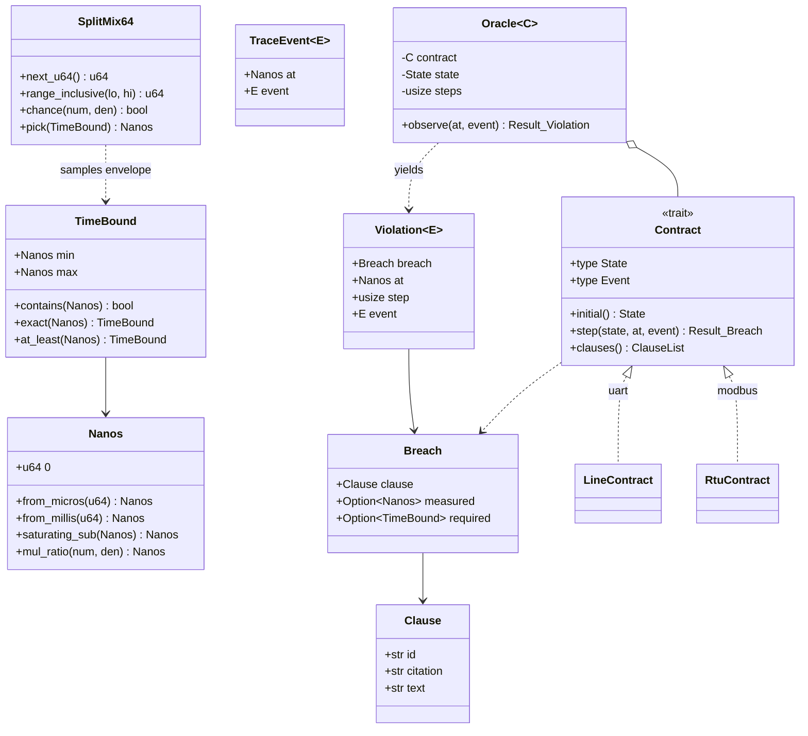
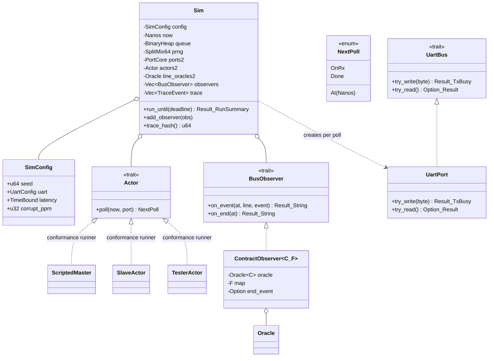
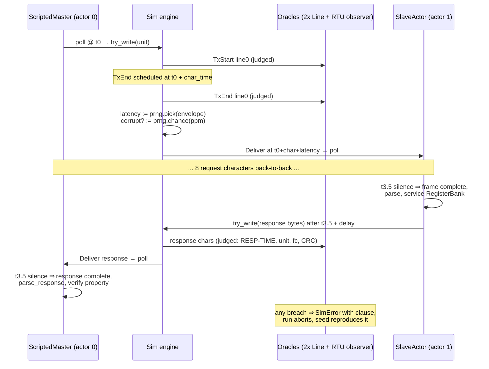
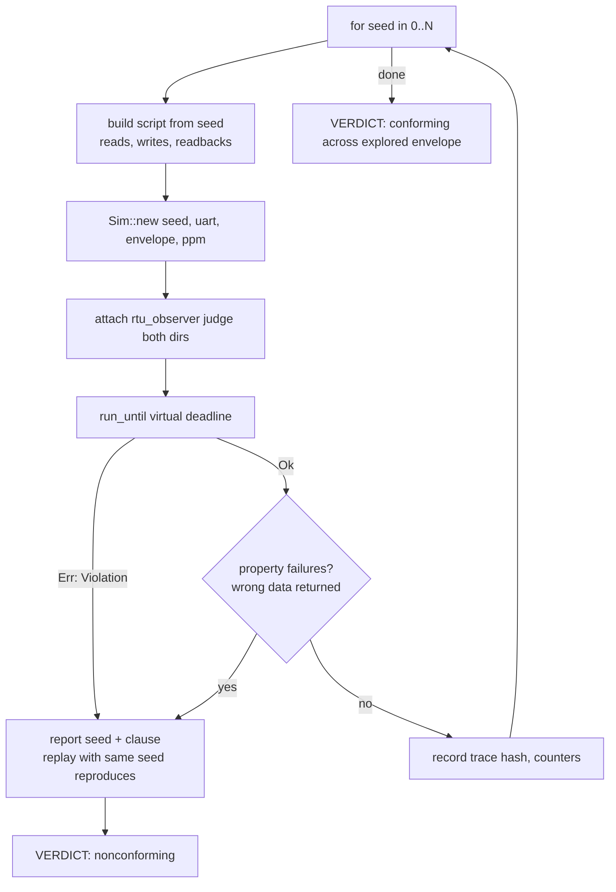
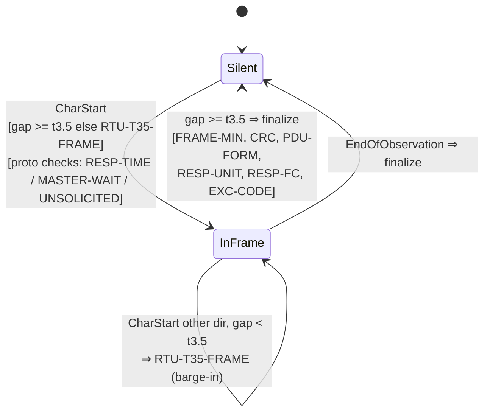
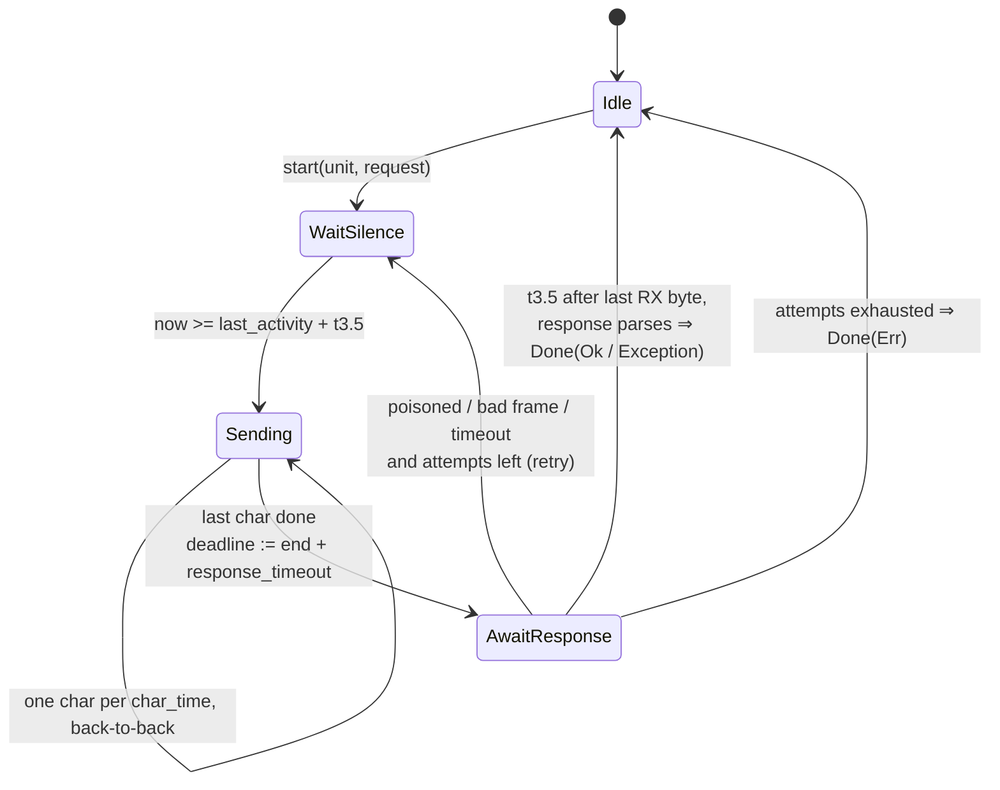
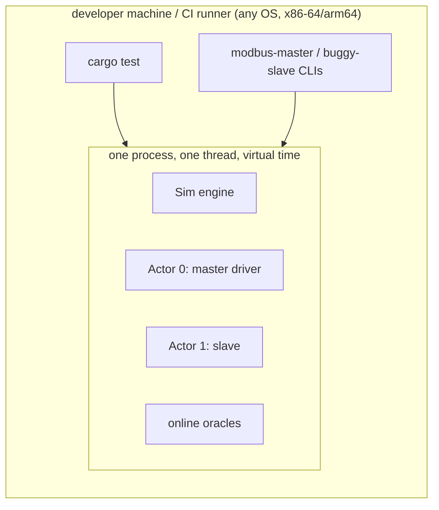
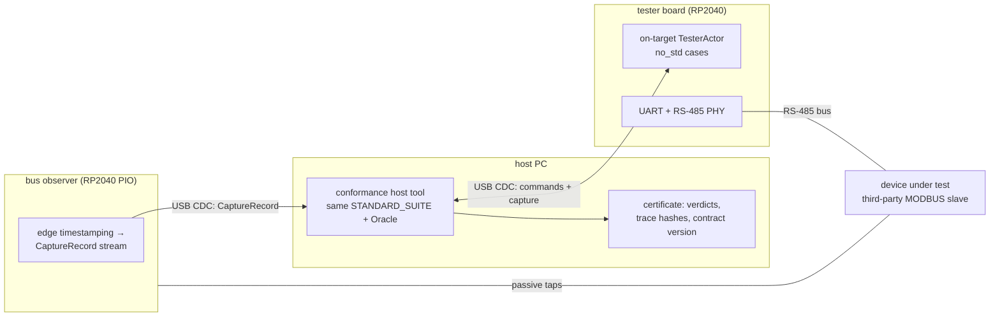

# StableHAL — Architecture Specification (arc42)

Version 0.1.0 — 2026-07-07 — status: implemented (M0–M4), hardware phase specified but deferred.

This document follows the [arc42](https://arc42.org) template. Code references
point into this repository; the scientific argument lives in
[paper/whitepaper.md](../paper/whitepaper.md).

---

## 1. Introduction and Goals

### 1.1 Requirements overview

Embedded software validated against HAL-level simulation still fails on real
hardware, forcing a costly integration test per release. Root cause: a HAL is
an interface *signature*, not an *agreement* — it binds neither side to
behavior, ordering, timing, or fault envelopes.

StableHAL's requirement set:

| Id | Requirement |
|----|-------------|
| R1 | The HAL boundary is governed by an **executable contract**: state machine + timing envelopes + closed fault vocabulary, each clause citing the governing spec. |
| R2 | A **simulation environment** explores the *entire* contract-allowed envelope deterministically (seeded), not a single happy-path trace. |
| R3 | The **same oracle** judges simulated traces and hardware captures (`no_std`), closing the SW↔HW loop. |
| R4 | A **conformance suite** is derived from the contract and can run against simulated and real devices alike. |
| R5 | Every failure **replays byte-for-byte from its seed**. |
| R6 | Pilot protocol: MODBUS RTU over UART (FC 03/06/10 subset, unicast). |

### 1.2 Quality goals (top 3)

| Priority | Quality | Scenario |
|---|---|---|
| 1 | **Determinism / reproducibility** | Re-running any seed produces an identical wire trace (asserted by FNV-1a trace hash). No wall clock, no OS entropy, no hash-order dependence anywhere. |
| 2 | **Verdict precision** | Every violation names one clause, with measured-vs-required values and a spec citation; a conforming implementation is never falsely accused. |
| 3 | **Portability of judgement** | Contract kernel, protocol contracts, drivers and conformance case definitions are `no_std`, so on-target execution requires no rework of the judging code. |

### 1.3 Stakeholders

| Stakeholder | Concern |
|---|---|
| Device-driver developers | Write drivers against `UartBus`-style traits; test across the full envelope on the host. |
| Hardware/board vendors | Certify a board revision once against the conformance suite. |
| Application developers | Trust that "passes DST + certified HW" composes without per-release integration testing. |
| Researchers (whitepaper) | Reproducible measurements; explicit limits of the transitivity claim. |

---

## 2. Constraints

| Id | Constraint | Rationale |
|---|---|---|
| C1 | Rust, edition 2021. | Type-state, `no_std` targets, host+MCU from one codebase. |
| C2 | **Zero external dependencies** in all `crates/*`. | Determinism auditability; nothing outside our control injects entropy or platform variance. |
| C3 | Judging code (`stablehal-contract`, `-uart`, `-modbus`, conformance case definitions) is `no_std`. | R3. |
| C4 | Virtual time only (`Nanos`, u64 nanoseconds); wall clock is forbidden in every crate. | R5. |
| C5 | One PRNG stream (`SplitMix64`) per run, seeded from the run's seed; it is the *only* entropy source. | R5. |
| C6 | Integer arithmetic only in timing derivations (`Nanos::mul_ratio`); every component derives bounds through the same functions. | Simulator, driver, and oracle must agree to the nanosecond. |

---

## 3. Context and Scope

### 3.1 Business context

### 3.2 Technical scope

**In scope (v0.1):** UART line contract; MODBUS RTU wire contract; conforming
master driver + reference slave; two-device simulator with latency/corruption
envelopes; conformance runner on the simulator; DST sweep tooling.

**Out of scope (documented, deliberate):** physical layer (EMI, analog
margins, silicon errata outside the fault vocabulary); broadcast (unit 0);
function codes beyond 03/06/10; multi-drop topologies (more than 2 devices);
the on-target runner (specified in [design-spec-next.md](design-spec-next.md)).

---

## 4. Solution Strategy

| Problem | Strategy |
|---|---|
| Sim ≠ HW | Don't imitate hardware; **contractualize** it. Hardware nondeterminism becomes explicit envelopes (`TimeBound`) and a closed fault vocabulary; the simulator samples the envelope, seeded. |
| Trust in the simulator | The wire is *conforming by construction* **and** still judged online by the same oracle — the claim is checked every run, not assumed. |
| Trust in hardware | The conformance suite derives from the clause list and is judged by the identical `no_std` oracle over captured traces. |
| Integration guarantee | Transitivity: DST proves SW ⊨ C over the envelope; certification proves HW ⊨ C; hence SW+HW interoperate to the extent C is complete (stated limit). |
| Tester must be able to cheat | Judgement is per-direction (`judge_master` / `judge_slave` flags): a conformance tester deliberately violates master-side clauses while the DUT stays fully judged. |

---

## 5. Building Block View

### 5.1 Level 1 — workspace

Dependency rule: arrows only point "down" toward the kernel. `stablehal-sim`
never depends on `stablehal-modbus`; protocol knowledge reaches the simulator
only through the `BusObserver` interface.

**I2C (WP2 §2.2)** is a second, independent protocol stack added alongside
MODBUS, deliberately not sharing code beyond the kernel: `stablehal-i2c`
(`no_std`: `I2cContract`, `I2cMaster`/`I2cSlaveDevice` traits,
`RegisterPointerDevice`, `ScriptedMaster`) depends only on
`stablehal-contract`, mirroring `stablehal-modbus`'s shape but with its own
event enum (`I2cEvent`, never merged with `LineEvent`). `stablehal-sim`
gained a second, self-contained world — `stablehal_sim::i2c::I2cWorld` — that
builds its own `Scheduler<Job>` the same way `Sim` does, rather than reusing
`Sim`'s 2-actor UART-shaped engine. `stablehal-conformance::i2c` follows the
same `no_std`-core / `runner`-feature split as the MODBUS suite. See
`docs/user-guide-i2c.md` for the full API walkthrough and clause table.

#### Clause registry

| Contract | Version | Clauses | Certificate `contract` code |
|---|---|---|---|
| uart-line | 0.1 | 3 | 0x0002 |
| modbus-rtu | 0.1 | 12 | 0x0001 |
| i2c | 0.1 | 7 | 0x0003 (reserved) |

I2C v1 clauses (full text and citations in `docs/user-guide-i2c.md` §5):
`I2C-SEQ`, `I2C-BUS-FREE`, `I2C-BYTE-TIME`, `I2C-READ-NACK-LAST`,
`I2C-ADDR-ACK`, `I2C-STRETCH-MAX`, `I2C-WRITE-ACK`. `I2C-ARBITRATION` is
reserved for v2 multi-master support and is not implemented.

### 5.2 Level 2 — domain model (kernel)

### 5.3 Level 2 — simulator

Key mechanism: drivers (`RtuMaster`, `RtuSlave`) are `no_std` poll-driven
state machines written **only** against `UartBus` + a `now: Nanos` parameter.
The sim adapts them via thin `Actor` wrappers. On target the same drivers are
polled from an ISR/loop with a hardware timebase.

### 5.4 Level 2 — MODBUS building blocks

| Block | File | Responsibility |
|---|---|---|
| `crc` | [crc.rs](../crates/stablehal-modbus/src/crc.rs) | CRC-16/MODBUS + `check()` (wire order low-first). |
| `timing` | [timing.rs](../crates/stablehal-modbus/src/timing.rs) | `RtuTiming`: t1.5 / t3.5 (fixed values > 19200 baud), response envelope. |
| `pdu` | [pdu.rs](../crates/stablehal-modbus/src/pdu.rs) | `Adu` (256-byte, no-alloc frame buffer), request/response builders and validating parsers. |
| `contract` | [contract.rs](../crates/stablehal-modbus/src/contract.rs) | `RtuContract`: 12 clauses over `CharStart/CharEnd/EndOfObservation` events; per-direction judgement; frame assembly with poisoning semantics for waived violations. |
| `master` | [master.rs](../crates/stablehal-modbus/src/master.rs) | `RtuMaster`: WaitSilence → Sending → AwaitResponse FSM, t3.5 frame detection, retries, planted-bug knob. |
| `slave` | [slave.rs](../crates/stablehal-modbus/src/slave.rs) | `RtuSlave` + `RegisterBank` + `SlaveBugs` catalog (each bug breaks exactly one clause). |

---

## 6. Runtime View

### 6.1 One MODBUS transaction under DST

### 6.2 DST sweep (activity)

### 6.3 RTU wire contract — line phase FSM

Protocol overlay (`Proto`): `ExpectRequest ⇄ AwaitResponse{unit, fc,
request_end}` — set by a finalized valid master frame, cleared by a finalized
slave response or a legal (post-timeout) retry.

### 6.4 Master driver FSM

---

## 7. Deployment View

### 7.1 Current (v0.1): single host process

No threads, no I/O, no clocks: determinism holds on any host. A 10,000-seed
sweep (~9.9M judged wire events) completes in ~10 s single-core; sweeps are
embarrassingly parallel across seeds if ever needed.

### 7.2 Target (deferred hardware phase — specified, not built)

Interface details: [design-spec-next.md §3](design-spec-next.md).

---

## 8. Crosscutting Concepts

### 8.1 Determinism (the load-bearing concept)

1. **Virtual time only.** `Nanos` is the sole time type; `std::time` is not
   imported anywhere.
2. **Single entropy source.** `SplitMix64::new(seed)`; draws happen in event
   order (defined by the queue), so consumption order is itself deterministic.
3. **Total event order.** The scheduler orders by `(at, seq)`; `seq` is the
   insertion counter — no `HashMap` iteration, no OS scheduling.
4. **Stable fingerprints.** FNV-1a over the canonical `Debug` rendering of the
   trace (integers only) — platform-independent hash, asserted equal on replay.

### 8.2 Contract semantics

* **Envelopes, not points**: every timing term is a `TimeBound`; a spec that
  says "at least t3.5" becomes `at_least(t35)`; tolerance terms (UART char
  time ±2%) are explicit contract parameters.
* **Closed fault vocabulary**: `UartError {Framing, Parity, Noise, Overrun}`
  is exhaustive; the environment may only inject from this set, and drivers
  must tolerate exactly this set.
* **Per-direction judgement with waiver semantics**: a waived (unjudged)
  breach *poisons* the affected frame — it carries no protocol meaning, which
  models how real receivers discard garbage — while the judged party remains
  fully accountable.
* **Judgement of transmitter truth**: oracles consume `TxStart/TxEnd`
  (what a party emitted), never `Delivered*` (what the channel did to it), so
  environment corruption is never blamed on an endpoint.

### 8.3 Error handling & reporting

`Breach` (clause + measured + required) → `Violation` (adds time, step,
offending event) → rendered with spec citation. Anything that fails renders a
seed and is reproducible; honest driver failures (retries exhausted) are
*results*, not violations.

### 8.4 Testing strategy

| Layer | Where | What |
|---|---|---|
| Unit | each crate `#[cfg(test)]` | CRC spec vector, timing derivations, contract clause triggers, PRNG stability. |
| DST harness self-test | [dst.rs](../crates/stablehal-sim/tests/dst.rs) | Planted envelope-dependent bug found by sweep; exact replay; seed divergence. |
| Closed loop | [closed_loop.rs](../crates/stablehal-conformance/tests/closed_loop.rs) | Reference passes suite; 6/6 bug catalog caught with exact clause; master sweep clean; planted master bug caught. |
| Measurement | example CLIs | 10k-seed sweep, replay check — numbers feed the whitepaper. |

---

## 9. Architecture Decisions (ADRs)

| # | Decision | Status | Rationale / consequences |
|---|---|---|---|
| ADR-1 | Contracts judge **wire truth per direction**, not deliveries. | accepted | Correct fault attribution under injected corruption; conformance testers can deliberately violate their own direction. |
| ADR-2 | Drivers are **poll-driven `no_std` state machines** (`poll(now, bus)`), not async. | accepted | Runs identically under sim scheduling and on bare metal; no executor dependence; wake-hint (`wake_at`) keeps sims efficient. |
| ADR-3 | **Zero external crates** in `crates/*`. | accepted | Auditable determinism; cost: hand-rolled PRNG/hash (~60 LoC), no rmodbus in core (adapter lives outside `crates/`). |
| ADR-4 | Simulator is **conforming by construction *and* self-judged**. | accepted | The "environment contract" claim is verified every run; a sim bug surfaces as a line-oracle violation (`SimError::Line`). |
| ADR-5 | Sim topology fixed at **2 devices / 2 simplex lines** for v0.1. | accepted | Covers master/slave pilot; multi-drop & shared buses (I2C) require the Medium abstraction — see [design-spec-next.md §2](design-spec-next.md). |
| ADR-6 | Higher-layer contracts attach via **`BusObserver`**, keeping `sim` protocol-agnostic. | accepted | `stablehal-sim` never imports modbus; new protocols plug in without touching the engine. |
| ADR-7 | Frame-oriented contracts get an explicit **`EndOfObservation`** event. | accepted | A trailing frame cannot escape judgement; harnesses must append it (the sim does this in `run_until`). |
| ADR-8 | Waived breaches **poison** frames instead of halting. | accepted | Lets one oracle instance serve both strict DST (judge all) and conformance probing (judge DUT only). |
| ADR-9 | `Adu` is a fixed 256-byte buffer (spec max), cloned freely. | accepted | No alloc in `no_std`; clippy "large enum variant" warnings accepted knowingly. |

---

## 10. Quality Requirements (scenarios)

| Quality | Scenario | Measure (v0.1 actual) |
|---|---|---|
| Reproducibility | Re-run any failing seed | identical trace hash + identical violation (asserted in CI) |
| Bug-finding power | Planted ~1%-per-transaction timing bug | found within 200 seeds; single mock trace misses it |
| Verdict precision | 6 cataloged slave bugs | 6/6 attributed to the exact clause; reference 13/13 pass |
| Throughput | 10,000-seed sweep | ~10 s single core, ~9.9M events judged |
| Safety property | 0.2%/char corruption injected | 0 silent data corruptions; failures are loud (retry-then-error) |

---

## 11. Risks and Technical Debt

| Id | Risk / debt | Mitigation |
|---|---|---|
| T1 | **Contract completeness** — a wrong-but-consistent contract passes both sides. | Clause↔spec traceability table; boundary probes at both envelope edges; treat field divergence as contract bugs (fix upgrades all three artifacts). |
| T2 | Envelope coverage is sampled, not exhausted. | Explicit envelope parameters; scale seeds in CI; planned boundary-biased sampling ([design-spec-next.md §4](design-spec-next.md)). |
| T3 | Response-timeout race (spec ambiguity: retry may collide with a maximally-late response). | Contract makes the race visible; deployments configure margins; documented in whitepaper §6. |
| T4 | Sim topology hardcoded to 2 devices. | Medium abstraction specified for I2C/multi-drop; do not extend ad hoc. |
| T5 | `expected_request_len` in [slave.rs](../crates/stablehal-modbus/src/slave.rs) exists only to implement a *bug* (early response); keep it out of reference paths. | Code comment + conformance case GAP-T15-ACCEPTED guards the legal path. |
| T6 | Clippy warnings (large enum variants, complex runner types). | Accepted for v0.1 (ADR-9); revisit if `Adu` clones show up in profiles. |
| T7 | The conformance tester's listening window is length-aware but static. | Fine at 9600–115200 baud; recompute per case if very slow bauds are added. |

---

## 12. Glossary

| Term | Meaning |
|---|---|
| **ADU / PDU** | MODBUS Application Data Unit (unit + PDU + CRC) / Protocol Data Unit (fc + data). |
| **Bounded nondeterminism** | Real-world variance expressed as an explicit contract envelope (`TimeBound`) or closed fault set, so it can be sampled and judged. |
| **Clause** | One checkable obligation, with stable id and spec citation. |
| **Conforming by construction** | The simulated wire physically cannot emit contract-forbidden character patterns (and is still judged online). |
| **DST** | Deterministic simulation testing: all nondeterminism seeded and pluggable; failures replay from the seed. |
| **DUT** | Device under test (conformance). |
| **Envelope** | The `min..=max` band of allowed values for a timing term. |
| **Oracle** | Folds a timestamped event trace through a contract; yields conformance or the breached clause. |
| **Poisoned frame** | Frame stripped of protocol meaning after a waived (unjudged) breach — models receivers discarding garbage. |
| **t1.5 / t3.5** | MODBUS RTU character-time multiples bounding intra-frame gaps / delimiting frames (fixed 750 µs / 1.75 ms above 19200 baud). |
| **Trace hash** | FNV-1a fingerprint of the canonical wire trace; equality across runs proves replay exactness. |
| **Waiver** | Direction excluded from judgement so a tester may deliberately violate; never applied to the DUT. |
